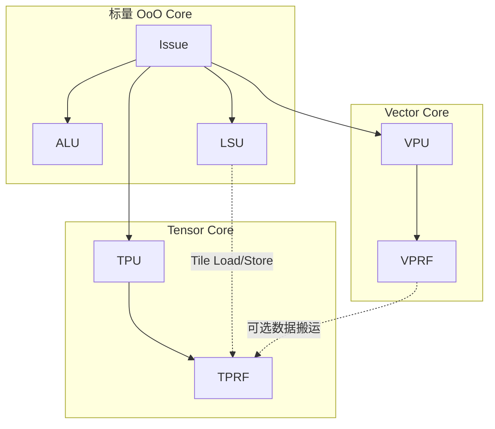
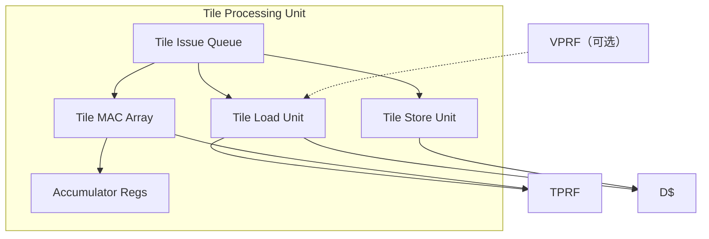
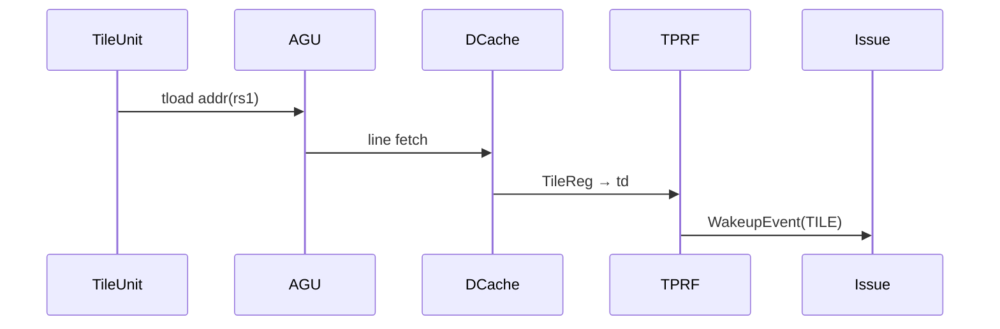

# Tensor Core（Tile Core）实现方案

本文档给出 RV-TCore **Tensor / Tile 执行子系统（Tensor Core / TPU）** 的实现方案。当前代码库中 Tile 寄存器堆（TPRF）与重命名骨架已落地，Tile 指令集与执行语义待按本文档扩展。寄存器堆细节见 [VRegFile-TRegFile.md](./VRegFile-TRegFile.md)，重命名见 [Vector-Tile-Rename.md](./Vector-Tile-Rename.md)。

---

## 1. 定位与目标

### 1.1 与 Vector Core 的关系

| 维度 | Vector Core (VPU) | Tensor Core (TPU) |
|------|-------------------|-------------------|
| 数据形态 | 1D 向量（VLEN 位宽） | 2D Tile 矩阵（如 16×16） |
| 寄存器 | v0–v31，VPRF | t0–t7，TPRF |
| 典型运算 | 逐元素算术、load/store | 矩阵乘加（MAC）、累加 |
| 与 GPR 交互 | VX 类读标量 | 地址/标量控制 |
| 与 Vector 交互 | 独立域 | load/store tile、向量化填充 |



### 1.2 设计目标

| 阶段 | 目标 |
|------|------|
| Phase 1（当前） | TPRF + TRAT + TileUnit 骨架，简化 tile 加法 CA 模型 |
| Phase 2 | Tile load/store、矩阵 MAC 指令集、累加器语义 |
| Phase 3 | 多 TPU、与 Vector 协同、算子融合 |

---

## 2. 当前实现状态（Phase 1）

### 2.1 已实现

| 模块 | 路径 | 状态 |
|------|------|------|
| TPRF / TRegFileUnit | `rename/tprf.h`, `tregfile_unit.*` | ✅ |
| TRAT 重命名 | `rename_unit.cpp::rename_tile` | ✅ |
| TileUnit | `execute/tile/tile_unit.*` | ✅ 骨架 |
| Issue `m_tensor_q` | `issue_unit.cpp` | ✅ |
| Commit Tile 写回 | `commit_unit.cpp` | ✅ |

### 2.2 未实现

- Tile 专用指令解码（`InstType::TILE` 需测试手动设置）
- Tile load/store 与 LSU 协同
- 矩阵乘加（GEMM）计算内核
- Tile 与 Vector 之间的数据搬运指令

### 2.3 TileUnit 流水线

与 `VectorUnit` 同构：

```
dispatch → pipe[stages] → commit_latch
R1: 读 ts1/ts2 from tpu_resp_q，bypass wakeup(td)
E0: exec_tile() → td_payload
Commit: TileRegReq(write) → TPRF
```

当前 `exec_tile()`：两 Tile 源按字节相加，或单源拷贝。

### 2.4 TileReg 默认规格

| 参数 | 值 |
|------|-----|
| `RV_TILE_SIZE` | 8 架构寄存器 |
| `TPRF_CAPACITY` | 16 物理寄存器 |
| `TILE_ROWS × TILE_COLS` | 16 × 16 |
| `TILE_ELEM_BITS` | 32 |
| 单 Tile 字节数 | 1024 |

---

## 3. 目标架构（Phase 2/3）

### 3.1 Tensor Core 逻辑结构



### 3.2 功能单元

| 单元 | 职责 | 典型延迟（参考） |
|------|------|------------------|
| Tile Load | 从内存加载矩阵块到 TPRF | 与 D$ 相同 + 组装 |
| Tile MAC | C += A × B（分块矩阵乘） | 多周期（4–16） |
| Tile Store | TPRF 写回内存 | 与 D$ 相同 |
| Tile Move | TPRF 间拷贝、转置 | 1–2 周期 |

Phase 1 将上述功能合并入单一 `TileUnit`；Phase 2 可按延迟拆分。

---

## 4. 指令集规划（建议）

当前仓库尚无 Tile 专用 opcode，建议在 `include/isa/` 扩展 **自定义 Tensor 扩展（或对接现有矩阵扩展草案）**。

### 4.1 建议指令格式

| 指令 | 语义 | 操作数 |
|------|------|--------|
| `tload` | 从 [rs1] 加载 Tile 到 td | rs1(GPR), td(Tile) |
| `tstore` | 将 ts1 存储到 [rs1] | rs1(GPR), ts1(Tile) |
| `tmac` | td += ts1 × ts2 | ts1, ts2, td (Tile) |
| `tmov` | td = ts1 | ts1, td |
| `tzero` | td = 0 | td |
| `tadd` | td = ts1 + ts2（逐元素） | ts1, ts2, td |

### 4.2 InstType 与 Decode

```cpp
InstType::TILE
// decode 映射：
//   ts1.atag = rs1 field, ts2.atag = rs2 field, td.atag = rd field
//   ts1/ts2/td.rtyp = RegType::TILE
//   标量地址寄存器仍用 rs1(GPR)（tload/tstore）
```

### 4.3 与 RVV 的边界

| 场景 | 推荐路径 |
|------|----------|
| 逐元素向量算术 | Vector Core (RVV) |
| 固定分块矩阵乘 | Tensor Core |
| 向量→矩阵填充 | `tload` from vector memory layout 或专用 `vp2t` 搬运指令 |

---

## 5. 重命名与寄存器管理

### 5.1 当前策略：全重命名（策略 A）

每条写 `td` 的指令从 `tfree_list` 分配新物理 Tile 寄存器，与 GPR/Vector 模型一致。详见 [Vector-Tile-Rename.md](./Vector-Tile-Rename.md) §6。

### 5.2 累加器型策略（策略 B，可选）

若指令集语义为 **固定累加器寄存器**（类似部分 AI 加速器）：

- TRAT 基本固定映射，rename 仅处理临时 Tile
- `tmac` 写累加器时不分配新 ptag，仅置 busy
- 减少 TPRF 容量压力，但弱化 OoO 换名能力

**建议**：通用 RISC-V OoO 核心优先策略 A；嵌入式矩阵协处理器可考虑策略 B。

### 5.3 TPRF 容量规划

单 Tile 1024 字节，16 项物理寄存器 ≈ 16 KB 寄存器堆。

| 工作负载 | 建议 `tprf_capacity` |
|----------|----------------------|
| 单层 GEMM 分块 | 16–24 |
| 多层算子融合 | 32+ |
| 与 Vector 共享片上预算 | 按总面积权衡 |

---

## 6. Tile Load/Store 方案

### 6.1 地址与对齐

```
tload td, (rs1)
  AGU: addr = GPR[rs1]
  D$:  读取 TILE_ROWS × TILE_COLS × elem_bytes（连续或分 tile 行）
  TPRF: 写入 td 物理寄存器
```

### 6.2 与 LSU 集成

**方案 A — LSU 扩展端口（推荐）**

- AGU 使用现有 LSU 地址通路
- 数据宽度扩展：一次传输完整 `TileReg` 或分行多次
- `InstType::TILE` + 子类型 `TILE_LOAD` / `TILE_STORE` 进入 `m_ls_q` 或独立 `m_tile_mem_q`

**方案 B — TileUnit 内嵌访存**

- TileUnit 直接访问 DCache（需额外 D$ 读端口建模）
- 实现简单，但不利于 memory ordering 与 SQ 交互

### 6.3 时序示意



---

## 7. 矩阵乘加（MAC）微架构

### 7.1 计算模型

分块 GEMM：`C[M×N] += A[M×K] × B[K×N]`

每个 `tmac` 指令完成一个 **Tile 级块**：

```
td[M_t×N_t] += ts1[M_t×K_t] × ts2[K_t×N_t]
```

其中 `M_t, N_t, K_t` 与 `TILE_ROWS/COLS` 及数据类型相关。

### 7.2 数据类型支持（分阶段）

| 阶段 | 元素类型 | 说明 |
|------|----------|------|
| P1 | int32 | 简化 CA，逐元素乘加 |
| P2 | int8 / int16 | 扩展 elem_bits 配置 |
| P3 | fp16 / bf16 | 需浮点 Tile MAC 阵列 |

### 7.3 流水线阶段（目标）

| 阶段 | 操作 |
|------|------|
| T0 | 读 ts1, ts2 from TPRF |
| T1 | 并行乘法（MAC 阵列） |
| T2 | 累加树归约 |
| T3 | 写 td / 累加器，bypass wakeup |

默认 `TileConfig.stages = 4`，可按 MAC 阵列深度增至 8–16。

---

## 8. Issue 与调度

### 8.1 发射队列

| 参数 | Phase 1 | Phase 2 目标 |
|------|---------|--------------|
| 队列 | `m_tensor_q` | 独立 `TileIssueQueue` |
| 发射宽度 | `tile_issue_width = 1` | 1（MAC 占带宽大） |
| 调度 | Oldest-first | Oldest-first |

### 8.2 结构性冒险

| 冒险 | 处理 |
|------|------|
| TPRF 读端口不足 | 分 bank 或串行化读 |
| MAC 多周期占用 | `accept()` 背压，Issue 重试 |
| tload → tmac 依赖 | WakeupEvent(TILE) + IQ 等待 |

### 8.3 与 Vector 的协同发射

同一周期可发射：

- 1 条 Vector 指令（VPU）+ 0 条 Tile（资源争用 VPRF/TPRF 读端口时互斥）
- 或配置为 **独立发射宽度**，在 Top 层分别统计 stall

---

## 9. Commit 与写回

与 Vector 路径一致：

```cpp
// Commit::write_back
TileRegReq req;
req.write = true;
req.ptag = inst->td.ptag;
req.val = inst->td_payload;
tile_reg_req_q.write(req);

// Commit::retire_inst
m_tcrat[td.atag] = td.ptag;
rename.recycle_tile_phys(td.o_ptag);
```

Tile 指令若无 `td`（纯 store），仅消费 `ts1` 不产生 TPRF 写回。

---

## 10. 异常与调试

| 场景 | 处理 |
|------|------|
| Tile load page fault | 精确异常，flush 年轻指令，TRAT 恢复 |
| 对齐错误 | trap 或软件对齐假定 |
| MAC 溢出 | 可配置饱和或 trap（按扩展定义） |

建议在 `PerfStats` 增加：

- `tile_issue_stall_cycles`
- `tpu_mac_utilization`
- `tprf_port_conflict`

---

## 11. 分阶段实施计划

### Phase 1 — 骨架 ✅（当前）

- [x] TPRF / TRegFileUnit
- [x] TRAT rename / commit / flush
- [x] TileUnit 骨架（简化 tadd）
- [x] Issue / Execute / Commit 打通

### Phase 2 — 指令与访存

- [ ] 定义 Tile opcode 与 decode（`tload/tstore/tmac/tmov`）
- [ ] Tile load/store 与 LSU/D$ 集成
- [ ] 实现 int32 分块 MAC
- [ ] Tile 专用 Issue 队列或子类型调度
- [ ] 单元测试 + spike/参考模型对比

### Phase 3 — 性能与协同

- [ ] 多数据类型（int8/fp16）
- [ ] Vector ↔ Tile 搬运指令
- [ ] 算子融合（conv/GEMM 分块调度）
- [ ] Kanata / 性能计数器

---

## 12. 配置参考

```cpp
// rv_def.h
constexpr u32 RV_TILE_SIZE = 8;
constexpr u32 TILE_ROWS = 16;
constexpr u32 TILE_COLS = 16;
constexpr u32 TILE_ELEM_BITS = 32;

// CoreConfig 默认
tpu_num          = 1
tile_issue_width = 1
tprf_capacity    = 16
```

---

## 13. 关键源文件

| 文件 | 说明 |
|------|------|
| `include/execute/tile/tile_unit.h` | TileUnit 类 |
| `modules/backend/tile/tile_unit.cpp` | 流水线与简化执行 |
| `include/rename/tile_reg.h` | TileReg 数据结构 |
| `include/rename/tprf.h` | 物理寄存器堆 |
| `include/tregfile_unit.h` | 寄存器访问单元 |
| `modules/frontend/rename_unit.cpp` | `rename_tile` |

---

## 14. 相关文档

- [VRegFile-TRegFile.md](./VRegFile-TRegFile.md)
- [Vector-Tile-Rename.md](./Vector-Tile-Rename.md)
- [VectorCore-Design.md](./VectorCore-Design.md)
- [RV-TCore.md](./RV-TCore.md)
