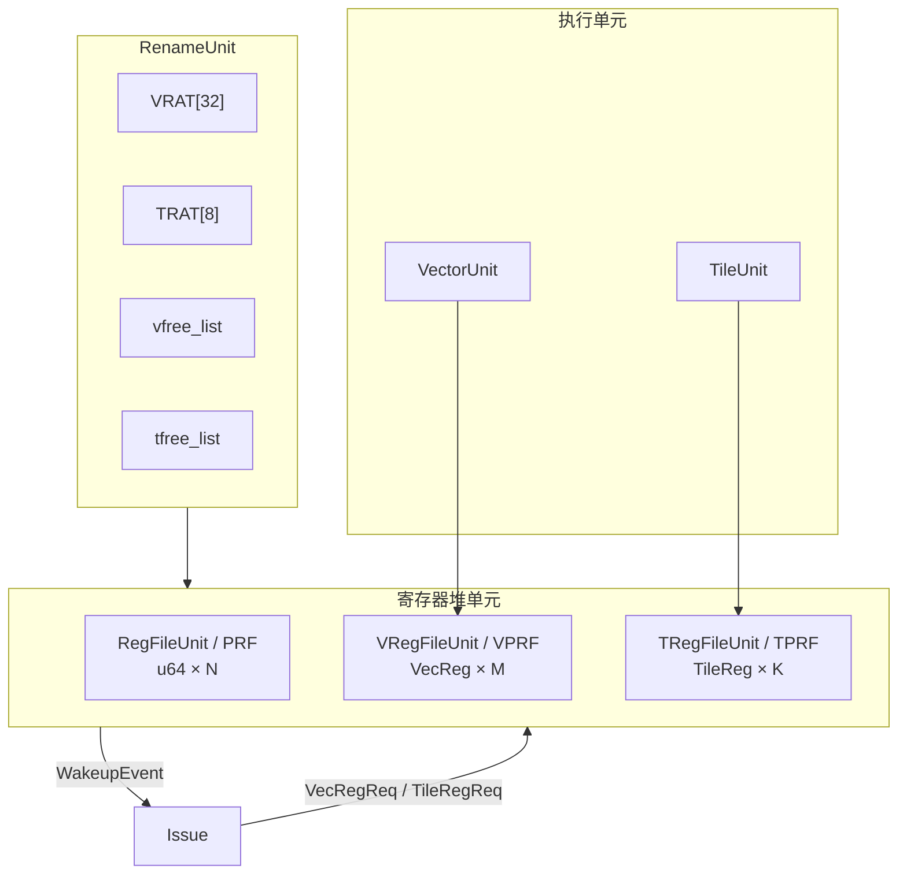
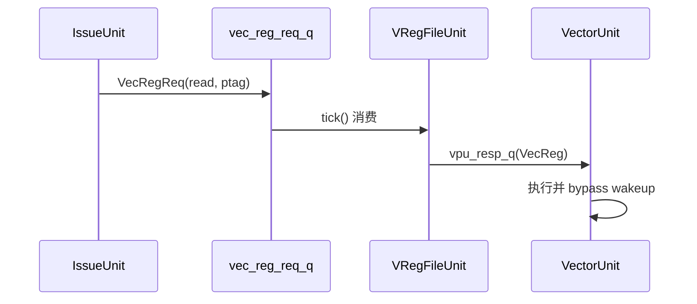
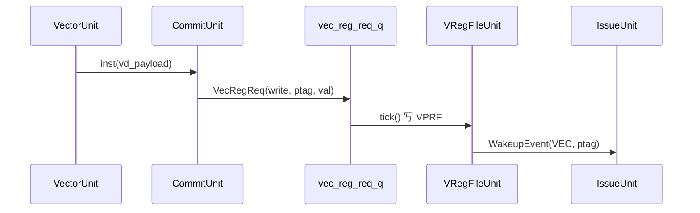

# VRegFile / TRegFile 寄存器堆实现方案

本文档描述 RV-TCore 中 **Vector 物理寄存器堆（VPRF）** 与 **Tile 物理寄存器堆（TPRF）** 的数据结构、接口设计、流水线交互及与标量 PRF 的关系。

---

## 1. 设计目标

| 目标 | 说明 |
|------|------|
| 分域独立 | Vector / Tile 与 GPR 使用独立物理寄存器空间，不复用标量 `PRF` |
| 接口复用 | 沿用 `RegReq/RegResp` + `WakeupEvent` 模式，扩展宽寄存器载体 |
| 与 Rename 解耦 | Rename 负责分配 ptag；RegFile 只负责读写与 busy 管理 |
| CA 模型优先 | 当前以功能正确性为主，宽数据用 `VecReg`/`TileReg` 承载 |

---

## 2. 总体架构



标量 GPR 仍由 `RegFileUnit` 管理；Vector / Tile 各自拥有独立的请求队列与响应总线。

---

## 3. 数据模型

### 3.1 寄存器域（RegType）

```cpp
enum class RegType {
    GPR,
    VEC,
    TILE,
};
```

`WakeupEvent`、`RegReq` 等结构通过 `rtyp` 区分唤醒与读写目标，避免不同域的 ptag 编号冲突。

### 3.2 VecReg（Vector 宽寄存器）

路径：`include/rename/vec_reg.h`

| 字段 | 含义 |
|------|------|
| `vlen` | 当前有效字节数（由 `vl × sew/8` 决定，CA 模型可简化为 VLEN_BYTES） |
| `vlmax_bytes` | 该物理寄存器容量上限 |
| `data` | 有效数据区（`std::vector<u8>`，RTL 可换成固定 `VLEN/8` 数组） |
| `valid` | 数据是否已写入 |

当前配置：`VLEN_BITS = 2048`，`VLEN_BYTES = 256`，LMUL=8 时最大 `MAX_VEC_REG_BYTES = 256` 字节。

### 3.3 TileReg（Tile 矩阵寄存器）

路径：`include/rename/tile_reg.h`

| 字段 | 含义 |
|------|------|
| `rows`, `cols` | Tile 维度（默认 16×16） |
| `elem_bits` | 元素位宽（默认 32 bit） |
| `data` | `rows × cols × elem_bits/8` 字节 |
| `valid` | 数据是否有效 |

默认单 Tile 大小：16 × 16 × 4 = **1024 字节**。

### 3.4 操作数描述（Operand 扩展）

`MicroOp` 在标量 `rs1/rs2/rd` 之外增加：

- Vector：`vs1`, `vs2`, `vd`，以及 `vd_payload`（执行结果）
- Tile：`ts1`, `ts2`, `td`，以及 `td_payload`
- 公共字段：`rtyp`、`rgrp`（LMUL 寄存器组大小）

---

## 4. VPRF 类设计

路径：`include/rename/vprf.h`，`modules/backend/vprf.cpp`

### 4.1 接口

```cpp
class VPRF {
    void reset();
    const VecReg& read(i32 pidx) const;
    bool write(i32 pidx, const VecReg& val);
    bool is_ready(i32 pidx) const;   // busy == false
    void set_busy(i32 pidx);
};
```

### 4.2 与标量 PRF 的差异

| 维度 | GPR PRF | VPRF |
|------|---------|------|
| 数据宽度 | 64 bit | 最大 `VLMAX × SEW`（可达数 KB） |
| 写回粒度 | 单条 u64 | 整条 vector（按 `vl` 有效区间） |
| 默认容量 | 192 | 64（可配置） |
| v0 语义 | x0 恒为 0 | v0 作 mask，映射到固定物理寄存器 0 |

### 4.3 reset 初始化策略

- 物理寄存器 0 保留给 **v0**（mask 寄存器），`busy[0] = false`
- 架构寄存器 v0–v31 初始 1:1 映射到物理 0–31（由 `m_vcrat` 与 Rename 协同）

---

## 5. TPRF 类设计

路径：`include/rename/tprf.h`，`modules/backend/tprf.cpp`

接口与 VPRF 同构，数据载体为 `TileReg`。

| 配置项 | 默认值 |
|--------|--------|
| `RV_TILE_SIZE` | 8（架构 Tile 寄存器数） |
| `TPRF_CAPACITY` | 16 |
| `TILE_ROWS × TILE_COLS` | 16 × 16 |
| `TILE_ELEM_BITS` | 32 |

---

## 6. VRegFileUnit / TRegFileUnit

路径：`include/vregfile_unit.h`，`include/tregfile_unit.h`

对标 `RegFileUnit`，在 `tick()` 的 `r0()` 阶段处理寄存器请求。

### 6.1 请求/响应结构

**VecRegReq / VecRegResp**

| 字段 | 读请求 | 写请求 |
|------|--------|--------|
| `valid`, `write` | ✓ | ✓ |
| `ptag`, `atag`, `idx` | ✓ | ✓ |
| `rid`, `fu` | ✓ | ✓ |
| `val` (VecReg) | 响应填充 | 请求携带 |

**TileRegReq / TileRegResp** 结构相同，载体为 `TileReg`。

### 6.2 处理流程（与 RegFileUnit 同构）

```
tick() → r0():
  1. 清空 vpu_resp_q / tpu_resp_q
  2. 从 vec_reg_req_q / tile_reg_req_q 取请求
  3. write: VPRF/TPRF.write + 广播 WakeupEvent(rtyp=VEC/TILE)
  4. read:  填充 VecRegResp/TileRegResp 到响应队列
```

### 6.3 对外服务接口

Rename 阶段通过以下接口查询/设置 busy：

```cpp
bool is_ready(i32 ptag) const;
void set_busy(i32 ptag);
```

---

## 7. 流水线通信

### 7.1 队列与总线（ModuleCommQueues）

| 队列/总线 | 类型 | 方向 |
|-----------|------|------|
| `vec_reg_req_q` | `ASyncQueue<VecRegReq>` | Issue/Commit → VRegFileUnit |
| `tile_reg_req_q` | `ASyncQueue<TileRegReq>` | Issue/Commit → TRegFileUnit |
| `vpu_resp_q` | `FixedArray<VecRegResp>` | VRegFileUnit → VectorUnit |
| `tpu_resp_q` | `FixedArray<TileRegResp>` | TRegFileUnit → TileUnit |
| `wakeup_bus` | `std::vector<WakeupEvent>` | RegFile → Issue（含 rtyp） |

### 7.2 读寄存器时序



### 7.3 写回时序



---

## 8. 配置参数

路径：`include/config.h`，`modules/config.cpp`

| 结构体 | 关键字段 | 默认值 |
|--------|----------|--------|
| `VRegFileConfig` | `capacity`, `vlmax_bytes` | 64, 32 |
| `TRegFileConfig` | `capacity`, `tile_rows/cols`, `elem_bits` | 16, 16×16, 32 |
| `RenameConfig` | `vprf_capacity`, `tprf_capacity` | 64, 16 |

---

## 9. Top 层实例化

`core/top.cpp` 中：

1. 创建 `vec_reg_req_q`、`tile_reg_req_q`、`vpu_resp_q`、`tpu_resp_q`
2. 实例化 `VRegFileUnit`、`TRegFileUnit`
3. 初始化 `m_vcrat[i]=i`、`m_tcrat[i]=i`（架构 1:1 映射）
4. 注入 `RenameDeps`、`CommitDeps`、`IssueDeps`、`VectorDeps`、`TileDeps`
5. `Core::tick()` 中在 `m_regfile.tick()` 之后调用 `m_vregfile.tick()`、`m_tregfile.tick()`

---

## 10. 关键源文件索引

| 模块 | 头文件 | 实现 |
|------|--------|------|
| VPRF | `include/rename/vprf.h` | `modules/backend/vprf.cpp` |
| TPRF | `include/rename/tprf.h` | `modules/backend/tprf.cpp` |
| VRegFileUnit | `include/vregfile_unit.h` | `modules/backend/vregfile_unit.cpp` |
| TRegFileUnit | `include/tregfile_unit.h` | `modules/backend/tregfile_unit.cpp` |
| VecReg | `include/rename/vec_reg.h` | — |
| TileReg | `include/rename/tile_reg.h` | — |

---

## 11. 后续演进方向

1. **Banking / 多端口建模**：按读端口数对 VPRF 分 bank，降低 CA 模型中的结构冲突
2. **Sub-element bypass**：按 element 粒度旁路（需与 `vl`、`vstart` 语义对齐）
3. **Copy-on-write**：降低 LMUL>1 时宽寄存器拷贝开销
4. **与 LSU 协同**：Vector load/store 数据通路直接写 VPRF，地址仍走 GPR

相关重命名方案见 [Vector-Tile-Rename.md](./Vector-Tile-Rename.md)；执行单元方案见 [VectorCore-Design.md](./VectorCore-Design.md) 与 [TensorCore-Design.md](./TensorCore-Design.md)。
