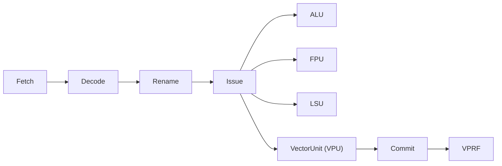
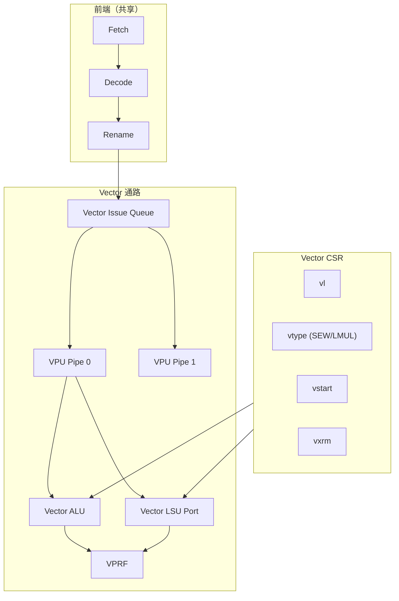
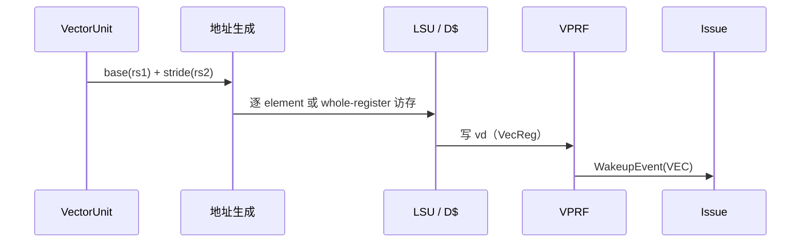

# Vector Core 实现方案

本文档给出 RV-TCore **Vector 执行子系统（Vector Core / VPU）** 的分阶段实现方案，涵盖当前已落地能力与后续演进路线。与寄存器堆、重命名相关的细节分别见 [VRegFile-TRegFile.md](./VRegFile-TRegFile.md) 与 [Vector-Tile-Rename.md](./Vector-Tile-Rename.md)。

---

## 1. 定位与目标

### 1.1 在 RV-TCore 中的位置

Vector Core 不是独立核心，而是 **标量 OoO 流水线上的 Vector 执行域**：



- 指令集：RISC-V Vector Extension（RVV），`insn32.decode` 已包含 Vector 指令定义
- 执行模型：与 ALU/FPU 相同的多级流水 + bypass + Commit 写回
- 寄存器：独立 VPRF，经 VRAT 重命名

### 1.2 设计目标

| 阶段 | 目标 |
|------|------|
| Phase 1（当前） | VPRF + VRAT + VectorUnit 骨架，支持 VV/VX 类算术指令 CA 仿真 |
| Phase 2 | Vector load/store、vl/vtype CSR、LMUL 完整语义 |
| Phase 3 | 多 VPU、Chaining、性能计数与 Kanata 可视化 |

---

## 2. 当前实现状态（Phase 1）

### 2.1 已实现模块

| 模块 | 路径 | 状态 |
|------|------|------|
| VPRF / VRegFileUnit | `rename/vprf.h`, `vregfile_unit.*` | ✅ |
| VRAT 重命名 | `rename_unit.cpp::rename_vector` | ✅ |
| VectorUnit | `execute/vector/vector_unit.*` | ✅ 骨架 |
| Decode 映射 | `decode_unit.cpp::map_vector_operands` | ✅ VV/VX/VI |
| Issue 分域调度 | `issue_unit.cpp::m_vec_q` | ✅ |
| Commit 写回 | `commit_unit.cpp::write_back` | ✅ |

### 2.2 VectorUnit 流水线

对标 `FPU`，采用 `input_latch → pipe[stages] → commit_latch` 结构：

```
dispatch → commit() → pipe[0]
tick():
  R1: 从 vpu_resp_q 读 vs1/vs2，发 bypass wakeup(vd)
  E0: exec_vector()，结果写入 inst->vd_payload
  shift: 推进流水级
commit_ready() → ExecuteUnit arbitration → inst_commit_q → Commit
```

默认 `VectorConfig.stages = 4`。

### 2.3 当前支持的执行语义（简化 CA）

`exec_vector()` 当前实现：

- **VV**（vs1 + vs2）：按字节相加，写入 `vd_payload`
- **VX**（rs1 标量广播 + vs2）：将标量按字节填充后与 vs2 相加（简化）

未建模：mask（v0）、`vl` 截断、`vstart`、饱和/舍入、分段异常。

### 2.4 配置参数

```cpp
// CoreConfig / TCoreConfig 默认值
vpu_num         = 1
vec_issue_width = 1
vprf_capacity   = 64
VLEN_BITS       = 2048
```

---

## 3. 目标架构（Phase 2/3）

### 3.1 逻辑框图



### 3.2 功能单元划分

| 单元 | 职责 | 指令示例 |
|------|------|----------|
| Vector ALU | 整数/浮点向量算术、比较、归约 | `vadd.vv`, `vmul.vv`, `vredsum.vs` |
| Vector Permute | 滑动、压缩、扩展 | `vslideup.vi`, `vcompress.vm` |
| Vector LSU | 单元步长/跨步/索引 load/store | `vle8.v`, `vlse32.v`, `vsuxei32.v` |
| Vector CSR | `vsetvl`, `vsetvli` | 配置 vl/vtype |

Phase 1 将所有算术归入单一 `VectorUnit`；Phase 2 起按延迟拆分或内部分功能队列。

---

## 4. 指令分类与发射策略

### 4.1 InstType 与 FuType

```cpp
InstType::VECTOR
FuType::VPU
```

### 4.2 Issue Queue 设计（目标）

| 参数 | Phase 1 | Phase 2 目标 |
|------|---------|--------------|
| 队列深度 | 复用 `m_vec_q`（vector） | 独立 `VectorIssueQueue`，24–32 entries |
| 发射宽度 | 1 | 1–2 |
| 调度策略 | Oldest-first（与标量一致） | Oldest-first + Chaining 优化 |

### 4.3 操作数就绪

| 操作数 | 来源 | ready 条件 |
|--------|------|------------|
| vs1, vs2 | VRAT → VPRF 读 | `WakeupEvent(VEC)` 或 bypass |
| rs1（VX） | RAT → PRF 读 | `WakeupEvent(GPR)` |
| vd | Rename 新分配 ptag | 无需等待（写后读由 wakeup 解决） |

---

## 5. Vector Load/Store 方案（Phase 2）

Vector 访存不走标量 LSU 数据通路，但**地址生成仍依赖标量寄存器**。



### 5.1 实现要点

1. **微操作展开**：`vle32.v` 可展开为 N 个 element load μop，或 whole-register 单次宽访存（CA 模型可选）
2. **与 SQ/LQ 交互**：Vector store 需进入 Store Queue 参与 memory ordering
3. **Fault-only-first**：`vle*ff` 需建模 `vl` 动态缩短
4. **vl 对齐**：有效写入区间 `[0, vl)`，其余保持 undisturbed（需 vtype 支持）

### 5.2 与 GPR LSU 的关系

| 项目 | 标量 LSU | Vector LSU |
|------|----------|------------|
| 地址寄存器 | rs1 (GPR) | rs1 (GPR) |
| 数据寄存器 | rd (GPR) | vd (VPRF) |
| 队列 | LQ / SQ | VLQ / VSQ（待建） |
| D$ 接口 | 共享 DCache | 共享 DCache |

---

## 6. CSR 与动态向量长度

### 6.1 关键 CSR

| CSR | 作用 |
|-----|------|
| `vl` | 当前向量长度（元素个数） |
| `vtype` | SEW、LMUL、vill 等 |
| `vstart` | 异常恢复起始索引 |
| `vxrm` | 固定点舍入模式 |
| `vcsr` | 向量状态聚合 |

### 6.2 vsetvl 处理流程

```
Decode: 识别 vsetvli / vsetvl
Rename: rd(GPR) 分配，读 rs1/rs2
Execute: 计算 new_vl，写 CSR，写 rd = vl
Commit: 更新 CRAT，无 VPRF 写回
```

### 6.3 与 Rename 的交互

- `vsetvl` 改变 **后续** Vector 指令的 `vl`/`lmul`，不直接改 VRAT
- LMUL 变化影响 `allocate_vec_group` 的组大小检查
- 建议在 `MicroOp` 携带快照：`uop.vl`、`uop.sew`、`uop.lmul`（Rename 或 Issue 阶段从 CSR 读取）

---

## 7. LMUL 与寄存器组

RVV 规定 LMUL>1 时，逻辑寄存器 `vd` 占用连续多个架构寄存器。

### 7.1 Rename 侧（已实现骨架）

```cpp
allocate_vec_group(vd, lmul, base_atag):
  分配 lmul 个连续物理寄存器
  更新 vrat[base_atag .. base_atag+lmul-1]
```

### 7.2 Execute 侧（待实现）

- 执行单元按 `lmul × sew` 计算有效数据宽度
- Whole-register load/store（`vl1re8.v` 等）一次占用整组
- Commit 回收时需回收整组 `o_ptag`（见 Rename 文档 §9.3）

---

## 8. 异常与精确性

| 异常类型 | 处理 |
|----------|------|
| Vector load page fault | 设置 `vstart`，flush 年轻指令，保留 vl |
| Illegal instruction | `vill=1` 或 trap |
| 分段执行 | 按 `vstart`/`vl` 区间重放 |

精确异常要求：Commit 点之前的 Vector 指令效果可回滚（VRAT checkpoint + VPRF 未提交写）。

---

## 9. 性能建模（Phase 3）

### 9.1 计数器建议

| 统计项 | 说明 |
|--------|------|
| `vec_issue_stall_cycles` | Vector IQ 无就绪指令 |
| `vprf_read_stall` | VPRF 端口冲突 |
| `vpu_busy_cycles` | VPU 满载 |
| `vec_lsu_replay` | Vector load replay 次数 |

### 9.2 多 VPU 扩展

```cpp
ExecConfig.vpu_num = 2;
FixedStorage<VectorUnit, MAX_VPU_NUM> m_vpus;
// dispatch_round_robin 选择空闲 VPU
```

需评估：VPRF 读端口数 ≥ 各 VPU 读请求之和。

---

## 10. 分阶段实施计划

### Phase 1 — 基础设施 ✅（当前）

- [x] VPRF / VRegFileUnit
- [x] VRAT rename / commit / flush
- [x] VectorUnit 骨架（vadd 类简化执行）
- [x] Issue / Execute / Commit 打通
- [x] Decode vector 操作数映射
- [x] `vector_regfile_test`

### Phase 2 — 功能完备

- [ ] `vsetvl` / CSR 文件
- [ ] `vl`/`vstart`/`vm` 完整语义
- [ ] Vector load/store + VLQ/VSQ
- [ ] LMUL 组回收
- [ ] 扩展 `InstExec` 或独立 `VectorExec` 指令分派表
- [ ] 更多 RVV 算术指令（mul、shift、compare）

### Phase 3 — 性能与验证

- [ ] 双 VPU + banking VPRF
- [ ] Chaining（同周期读前序写）
- [ ] RVV 官方测试套件 / spike 对比
- [ ] Kanata trace Vector 事件

---

## 11. 关键源文件

| 文件 | 说明 |
|------|------|
| `include/execute/vector/vector_unit.h` | VectorUnit 类定义 |
| `modules/backend/vector/vector_unit.cpp` | 流水线与简化执行 |
| `modules/frontend/decode_unit.cpp` | Vector 操作数映射 |
| `modules/frontend/rename_unit.cpp` | `rename_vector` |
| `modules/backend/issue_unit.cpp` | `m_vec_q`、VecReg 读请求 |
| `modules/backend/commit_unit.cpp` | Vector 写回 VPRF |
| `include/isa/opcode.h` | `is_vector()` |

---

## 12. 相关文档

- [VRegFile-TRegFile.md](./VRegFile-TRegFile.md)
- [Vector-Tile-Rename.md](./Vector-Tile-Rename.md)
- [TensorCore-Design.md](./TensorCore-Design.md)
- [RV-TCore.md](./RV-TCore.md) — 总体微架构
